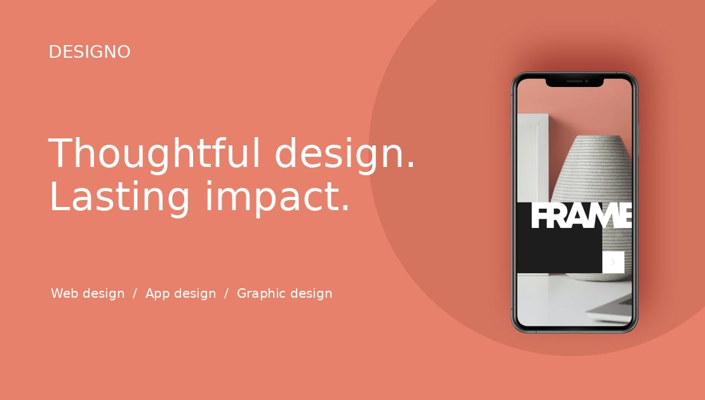

# Designo Studio

A seven-page creative studio website with responsive service pages, project dialogs, office information, and a validated contact API backed by a persistent database.

**React 19 · TypeScript · Vite / Vinext · Tailwind CSS 4 · Cloudflare Workers · D1 / SQLite · Drizzle migrations · Node test runner**

## Live website

**[Open Designo Studio](https://designo-studio.shaficp.chatgpt.site)**

[Source code](https://github.com/RamtinBabaei/designo-studio) · [Quality checks](https://github.com/RamtinBabaei/designo-studio/actions)

The hosted demo includes all seven pages and the persistent contact API. Contact submissions are stored in the database; email notifications are not enabled. Please use sample details when trying the form.



## Run locally

Use Node 24 (the implementation was tested with Node 24.19.0), Git, and pnpm 11.25.0. Node >=22.13.0 is the framework minimum. You do not need a database server, Cloudflare login, email key, or a paid service for local development. The local D1 emulator stores data on disk.

Open this folder in VS Code, then run each command separately:

```sh
npm install --global pnpm@11.25.0
pnpm install --frozen-lockfile
pnpm setup:local
pnpm dev
```

Open the **Local** URL printed by the terminal (normally http://localhost:5173). Keep the terminal running. `setup:local` builds once and applies migrations to the local database. Subsequent sessions need only `pnpm dev`. The `.sites-runtime` and `.wrangler` directories are generated automatically and should never be copied from another computer.

On Windows PowerShell, use `pnpm.cmd` instead of `pnpm` if script execution policy blocks the command. Do not type a filename such as `.github/workflows/ci.yml` as a terminal command: open it in VS Code. The Persian walkthrough is [docs/LOCAL_SETUP_FA.md](docs/LOCAL_SETUP_FA.md).

## Commands

| Command | Purpose |
| --- | --- |
| `pnpm dev` | Local development with hot reload |
| `pnpm setup:local` | Build and initialize/update the local database |
| `pnpm db:generate` | Generate a schema migration after editing `db/schema.ts` |
| `pnpm db:migrate:local` | Apply pending local migrations; safe to rerun |
| `pnpm typecheck` | Strict TypeScript checks |
| `pnpm test` | 16 validation/API/database tests |
| `pnpm check:assets` | Required assets and image-size budgets |
| `pnpm test:http http://localhost:5173` | Seven page + live contact integration checks against your running local server |
| `pnpm build` | Production Worker and client bundle |
| `pnpm start` | Run the built production Worker locally |

`test:http` writes a sample inquiry to your local database. It intentionally refuses remote hosts. It is an HTTP integration check, not a browser interaction or accessibility audit.

## Features

- Seven fully implemented routes, responsive layouts, a mobile menu, and active navigation.
- Original challenge artwork with optimized local assets and Jost typography.
- Fourteen project concepts with native accessible dialogs and contextual contact links.
- Three offices with local map previews and optional OpenStreetMap embeds.
- Client/server form validation, required-field focus, loading/retry/success states, and complete message persistence.
- Atomic duplicate protection, streaming body limits, origin checks, a honeypot, parameterized SQL, and indexed rate limiting.
- Page metadata, Open Graph image, a skip link, visible focus, semantic structure, and reduced-motion support.
- Reproducible migrations, automated tests, CI, and a portable local setup.

**Contact behavior:** success means the brief was saved in D1. No email notification is sent. Office phone numbers/email addresses are fictional challenge content. Use sample data in this portfolio demo. There is no admin dashboard or public endpoint listing stored messages.

## Structure

```text
app/                   Pages, shared layout, contact and health API routes
components/designo/    Reusable navigation, service tiles, dialogs, maps, form
lib/content.ts         Services, projects, values, and office content
lib/contact/           Validation, HTTP handler, D1 repository
db/                   Drizzle schema and database helper
drizzle/              Committed SQL migrations and schema metadata
public/                Optimized local images, fonts, favicon, Open Graph asset
tests/                 Native Node tests using a real SQLite database
scripts/               Local setup, migrations, HTTP checks, framework helpers
docs/                  Scope, architecture, verification, setup, deployment
.github/workflows/     GitHub CI checks
```

## Deployment

This project contains server functionality and **cannot run as a full-stack app on GitHub Pages**. GitHub is suitable for the source repository and CI. The hosted version uses Sites with a Workers runtime and a provisioned D1 binding. Standalone Cloudflare deployment requires a real D1 database and a real Wrangler configuration; see [docs/DEPLOYMENT.md](docs/DEPLOYMENT.md). Do not deploy a placeholder database ID.

## Verification and limits

Read [docs/TEST_REPORT.md](docs/TEST_REPORT.md) for executed checks and outstanding browser verification. The app has not been assigned invented Lighthouse scores. The reference's paid Figma/Sketch files were not supplied; exact pixel comparison has not been verified. Vinext is a beta framework dependency from the supported Sites runtime and should be evaluated before an independently operated production rollout.

## Implementation summary

Implemented a responsive seven-page creative agency experience with React and TypeScript, backed by a Cloudflare Workers contact API and D1 database. Built reusable page templates, progressive interactions, and a shared validation pipeline. Added atomic idempotency and abuse controls, optimized image delivery, schema migrations, and automated API/database regression tests.

Attribution and asset terms: [docs/ASSET-CREDITS.md](docs/ASSET-CREDITS.md). Scope: [docs/REQUIREMENTS.md](docs/REQUIREMENTS.md). Design and artwork: Frontend Mentor; application implementation: Ramtin Babaei portfolio project.
